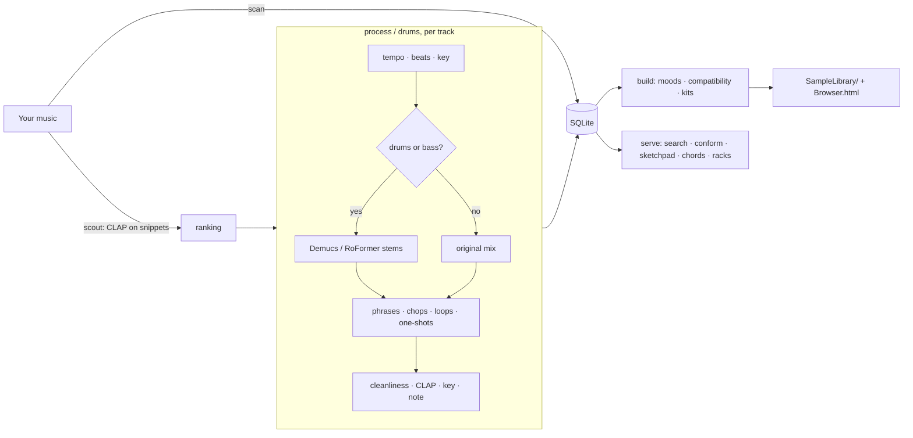

# DigitalCrate guide

Everything the [README](../README.md) skips. The small **?** buttons in the app explain features in place too.

- [Browse](#browse) · [Sketchpad](#sketchpad) · [Drum lane](#drum-lane) · [Mashup](#mashup) · [Chords](#chords) · [Pads](#pads) ·
  [Drum Racks from songs](#drum-racks-from-songs) · [Search](#search) · [Editing](#editing) · [Taste](#taste) ·
  [Scout](#scout) · [Organizing](#organizing) · [Mining](#mining-and-sources) · [Export](#export) · [Keyboard and MIDI](#keyboard-and-midi) ·
  [How it works](#how-it-works) · [Command line](#command-line) · [Library on disk](#the-library-on-disk) ·
  [Configuration](#configuration)

## Browse

- **Tabs** for each category (with counts), **🎲 Crate**, an **Artists** view (artist → album → song), and filters for
  *this track · this album · this artist* in the sample panel.
- **★** keeps a sample (linked into `Favorites/`); **✕** means *not for me*: it disappears and teaches the taste model.
- **🗑 delete** removes a sample; *Same song* deletes everything cut from a song (favorites and edits are kept).
  Deleted files go to a trash folder until `digitalcrate trash --empty`.
- **Goes well with** lists partners scored on key (Camelot wheel and the notes actually played), tempo, role and sound.
  **⧉** plays a pair together, **💾** saves it as a sketch.
- **🕘 Recent actions** lists every ★, ✕, category move, collection change and delete, each with undo.
- **Added recently** narrows any sort to the latest run, day or week.
- **∞ hold** on a pad, drone or held chord plays it and holds it on its seamless loop until you stop it.
- **🔁 takes:** a sample that comes round again in its song (the same drum hit, the same sung words, the same chord)
  is grouped with its other takes. Click the tag on a row to hear them back to back; the sample panel lists them with
  **▶ play all**, and **T** steps to the next take.
- **Pads** are sounds that hold one or two chords and keep still, so they loop and can be played. Sustained samples
  that move through more chords live in **Strings & Orchestral** (orchestral passages) or **Chords & Keys** (synth
  progressions); one-shots that die away (a struck key, a pluck) are in Chords & Keys. The panel shows a sample's own
  chords (*Fm → D♭*).
- **🎹 playable** (pads, strings, chords) makes an instrument for Live in `Playable pads/`: a Simpler preset tuned to
  the sample's chord, so each key plays it from that note and holds it on its loop, plus its chords as a MIDI clip to
  start from. **♪ MIDI** transcribes its actual notes.
- **Sections:** with song sections found, a filter picks samples from the intro, verse, chorus, a break or the
  outro (*intro · break · outro* are where songs are most exposed), and the panel says where a sample comes from.
- **Drag** any row into Live or Finder; **↗ Finder** shows the file.

## Sketchpad

Up to 8 lanes, in the project key and tempo. Open a kit in it or add samples with **＋**.

- **Timing:** amber lines are the project's bars and beats; white ticks are the clip's attacks. Rhythmic clips can
  **⟷ match tempo**; **↺ re-align** puts a selection's first attack on the beat; ⌥-drag slides a lane.
- **Per lane:** trim, on/off, solo, fades, repeat every N bars, keep its own key, and a relative fader (all start at 0 dB).
- **∞ hold** (in a lane's ⋯) sustains a pad on its loop for the whole repeat length, so a 3-second pad becomes a
  4-bar bed.
- **Tempo:** − / +, type it, or tap.
- **Arrangement:** type sections (`AABA`) and their length, then tick the sections each lane plays in.
- **Undo:** ↶ ↷ (⌘Z / ⌘⇧Z). **save •** turns amber with unsaved changes (⌘S). The sketch survives a refresh.
- **▾ hide** keeps it playing behind a small bar; samples you play are heard over it.
- **Out:** save, bounce to a new sample, **⇩ stems** (one WAV per lane, aligned from bar 1), or **⇩ Live set**
  (one track per lane, clips where it plays).
- **Kits** are dealt for you: a vocal the taste model likes, plus parts from other songs that fit it. **↻ new kits**
  deals again.

## Drum lane

Drum one-shots you add become pads in a step sequencer (16 steps a bar, 1 or 2 bars).

- **Steps:** click for on → soft → off; scroll for exact velocity; ⌥-click for a flam.
- **Feel:** swing, humanize, and choke groups (closed hat cuts off open hat).
- **🔁 takes** (round robin): a pad alternates between other hits of the same drum from the same song, so repeated
  hits sound played rather than copied. The rack export puts each take on its own pad and the MIDI follows the
  same order.
  - By default the takes play **in turn** (main, 2, 3, main…). **Shuffled** plays every take once in a random order,
    then a new order, never the same take twice running; 🎲 gives a different shuffle. Both play the same way every
    time, so bounces and exports match what you heard.
  - **⇧-click a step** to pin it to one take (the step shows its number); ⇧-click again to move on, back to auto.
  - The takes row under the pad plays each take (▶ 1, ▶ 2…), and **★** makes one the main hit. 🔁 shows or hides
    the row; **off** goes back to one take.
- **✨ starter** writes a pattern from the pad types.
- **🔎 complete the kit** suggests hits for the kinds you're missing that sound recorded alike (it compares the
  recording's character, not the drum type; AUC 0.83 at picking a song's own drums). **↻ more**, **✕** next,
  **≈** steer toward one hit. **🥁 build a kit around this** on any drum hit starts one.
- **Pads start on the hit** (most mined hits open with 20–40 ms of lead-in). Click a pad's name to trim, tune, shorten
  its decay, or open the full editor. Each pad has a volume fader; every change is heard immediately.
- **🥁 slice into pads** cuts a drum loop at its hits, each on its step, ready to re-sequence.
- **⇩ MIDI + rack** writes a Drum Rack of the pads and a MIDI clip of the pattern for Live.

## Mashup

**🎛 Mashup** recombines drums, tops, bass, vocals and "other" (keys, guitars, pads) from different songs on one
tempo and key. It's a prototype. See the [Mashup plan](plans/stems.md).
Each track has a header, a waveform and a row of effects. The header shows the stem, the song and the loop's bars.
Hover over the song for the full name and why that part was picked.

- **Prepare songs first.** `digitalcrate stems` separates the sources of your favorites plus some random mined songs
  (a few minutes a song, about 65 MB each) and keeps their stems. Reference-only artists are never used. Hip-hop gives
  vocals only. `digitalcrate stems --new-artists --random 100` takes songs by artists Mashup has nothing from yet,
  one song an artist. Open **songs prepared for Mashup** to put a song's stem straight into a track.
- **Keys within a song:** a long piece can pass through several keys. Each prepared song has a chord for every bar
  and a key for each stretch, and a part is shifted by the key of its own bars (the track shows it). Songs prepared
  earlier get this from `digitalcrate stems --chords-only` (about a second a song).
- **Mining for Mashup too:** on the Processing page, **also prepare them for Mashup** keeps each mined song's stems
  as well (from the separation mining already makes: about 80 MB and a minute more a song; a song with no drums,
  which mining leaves whole, is separated for Mashup too, about 2 minutes more; songs with no steady 4/4 are left
  out). From the command line:
  `digitalcrate process … --mashup`.
- **＋ new** starts a new mashup: an empty slate, with the name cleared, to build up track by track (🎲 on a
  track, or 🎲 all, deals when you want it). It asks first if you have unsaved changes.
- **Tops** holds the hi-hat, ride and crash. Pick them with the Tops button in the song list. Drums plays the
  rest of the kit once a song has Tops. **digitalcrate stems** makes Tops for earlier songs first, adding about
  15 to 20 MB per song. Use `digitalcrate stems --tops-only` to prepare just those songs. Until then, Drums plays
  the whole kit. Old Drums parts get their Tops on a track directly below as soon as the song has them.
- **The die** pulls another part that fits what's playing. Each track's next part is picked and rendered ahead of time,
  and the mixer tries to avoid songs it is already using. It moves through the library: each track remembers the
  songs it dealt lately (also after a reload) and leaves them out, and draws from the best-fitting quarter of the rest. **All** deals every unlocked track. **↶ ↷** go back and
  forward through its parts. **S** solos the track, **M** mutes it, and the volume slider resets to 0 dB on a double-click.
- **⋯** opens the track's options. **Choose the song** opens a search and uses the song's best-fitting bars (✕, **Esc** or a
  click elsewhere closes it). **Best fits…** lists the parts that fit the harmony playing best, in order, with how well each fits
  (the die draws from the good ones; this shows you the top 8 to 40): click one to hear it, and the next (it works for one-shot and pad tracks too). On a one-shot track, **More from this song…** lists the
  other samples cut from the same song, best fit first, whatever their length (loops left out). **Other takes** goes through other
  stretches of the same song. **Splice pieces…** builds the part from pieces of its song played one after the other: set each
  piece's bar and length (whole bars; ½ and 1½ are in the menu, and 12.5 as a bar means the middle of bar 12), add
  one with **＋ piece** or by **⌥-clicking** the waveform (**⌥⇧** for a half bar), drag a block to reorder (or use ←), remove with ✕. A piece can play backwards (**rev**), take
  twice or half as long (**2× long**, **½× long**, its pitch kept), or play several times over (**×2**, **×3**…: a loop
  within the loop); **＋ rest** adds a bar of silence. A
  strip shows what plays, left to right, each piece in its own color; the song's waveform shows where each comes
  from in the same color, and the play line goes through them in turn. **Crossfade** blends every join (and where
  the loop comes round): each piece runs on a moment into its song, fading out under the next. Moving the loop, or **one stretch again**, drops the splice.
  **Play it as a one-shot** turns the part into a one-shot track: the same audio, placed
  on steps of a cycle (it starts as once, then a rest of the same length), with a one-shot's trim, fades and warp;
  ↶ brings the loop back. **Keep on “all”** locks the part. **Duplicate** copies the track and its settings right
  below. **Empty this track** takes out its part. **Plays** changes the role, and **Remove the track** removes it.
  **＋ add slot** adds another track, up to sixteen. Drag a track by its name to move it up or down.
- **Pad tracks** hold a library pad (a held chord, strings, a vocal bed) under the cycle: add one with **＋ add slot →
  pad**. The die deals one whose notes sit on every bar's harmony, shifted to the key; it starts as one hit that
  lasts the whole cycle, going round the sample's seamless loop where the library found one, with a soft fade in and
  out. It is a one-shot track with **∞ hold** on (in **Shape**), so everything a one-shot does works: more hits
  re-attack the pad, and trim, fades and effects apply.
- **How a one-shot or pad is chosen to fit.** The die and the best-fits list go by the sample's notes against each
  bar's chords: chord tones count for it, other notes of the key a little, notes outside the key against it. The
  other one-shot and pad tracks count as harmony too. A sample that sits a little sharp or flat of the other tracks
  is dealt already tuned: its **ct** box shows the cents (set it to 0 to hear it as recorded).
- **A mashup left playing** can be stopped from any tab: **■ stop mashup** appears beside the Mashup tab.
- **Rating on a track:** a stem track has **+** and **−** (this part works here, or doesn't: they teach the
  recommendations for that part alone); a one-shot track has **fav** and **no**, the library's favorite and
  not-for-me for that sample. **Clear all** empties the mixer.
- **Move the loop.** The waveform shows the whole stem, with the loop lit and the rest gray. Drag the right edge to
  change the length, the left edge to change the start while holding the end, or inside to move the loop. Click the
  gray to start the loop there. With the waveform focused, **← →** move it and **⇧← ⇧→** shorten or lengthen it.
  The edges snap to whole mixer bars, up to 16. Half-time snaps to every second song bar and double-time takes two
  mixer bars per song bar. The old loop keeps playing until the new one is ready.
- **Zoom and pan.** Pinch or hold **⌘** or **Ctrl** while scrolling to zoom around the pointer, down to two bars.
  Swipe sideways or drag the gray to pan. Hover over a waveform for **Loop** and **Whole song**. **Loops** and
  **Whole song** at the top change the view across the mixer; tracks open on their loops, and your choice is
  remembered. The white line follows playback.
- **Pitch** takes semitones and cents, including on drums. Drag either number up or to the right for more, hold **Shift** for
  a drag five times finer, click it to type a value, or focus it and press **↑ ↓**. Double-click to reset. The line
  under a number shows where it sits in its range. The pitch changes when you let go. A track's semitones move that
  track against the key; they don't change the mashup's key or the other tracks.
- **Effects** are the same kind of numbers and follow as you drag. **EQ** has lo, mid and hi bands at 200 Hz, 1 kHz and 5 kHz. **Delay** has time in
  notes, feedback and amount. **Reverb** sends to the mixer's room, plate or hall, with the type and decay at the top.
  The dots on EQ, Delay and Reverb turn them on or off and keep their settings. **FX** switches those effects and
  harmonics together.
- **MASTER** turns on a light mastering chain for the mixer. It trims the low and high ends and adds compression
  and limiting. The readout shows the compressor's gain reduction during playback. The switch is on for new
  mixes and is kept with the mix.
- On stem tracks, **Harmonics** keeps the level steady as you add overtones, and a pure sub-bass starts at 100%.
  **Octave** gives new parts a clean octave above the lows, so a 45 Hz note gains a 90 Hz overtone that you can hear
  on monitors or headphones. Switch Octave off for the driven sound when you want higher overtones that carry on
  phone or laptop speakers. Parts saved before this switch keep their original sound.
- **Even** holds down stray bass peaks. It eases heavy sub when there is enough bass above it to balance against.
  It brings bass parts closer in loudness by ear. New bass parts start with Even on, and older parts open with it
  off. **FX** leaves Even as you set it. The dry Ableton export uses the same bass render.
- **GLUE**, beside **MASTER**, holds the loudest hits a little across Drums and Tops together. The number shows how
  much it is taking off while you play. Glue starts on and stays as set when you switch **FX**. When a drum part is
  prepared, its gain follows a −8 dBFS peak ceiling on its source kit.
- **Duck** starts on. Drums lower the Bass track's lows. Vocals lower the whole Tops track and the bands of Other
  where the voice is loud. These amounts start at 3 dB. Other's Duck has **vocals** and **drums** amounts under one
  switch. The drums amount starts at 2 dB when the mix or snapshot has no saved amount.
  Drag either amount from 0 to 12 dB to set how much room Other makes. **FX** leaves Duck as you set it. Muted
  tracks duck nothing. Older mixes and snapshots use the defaults for missing settings and keep any saved Duck switches.
- **One-shot tracks** play a library sample at chosen moments. Set a cycle of 1, 2, 4 or 8 bars and click a step to
  place or remove a hit. The die picks a sample that fits and keeps your steps. **Choose a sample** searches the
  library, **▶** plays it once, and **✦ Mashup** in the sample panel sends the current sample to a one-shot track.
  The sample follows the mashup's key, and the pitch numbers also change its speed. Bar numbers under the steps are
  tinted by how well it fits each bar's harmony. **Every time**, **every 2nd** and **every 4th** set how often the
  cycle plays. The waveform at each hit shows its length. Drag across **Trim** to choose the piece that plays, drag
  an edge to adjust it, or double-click for the whole sample. **Shape** opens a full-width waveform with a time
  axis and exact trim times. Hold **Shift** while dragging for finer control. The start and end buttons nudge by
  5 ms, or 1 ms with **Shift**. Use **fade in** and **fade out** to shape hits, and **warp** to fit the piece
  to ¼, ½, 1 or 2 bars at the mixer tempo while keeping its pitch, or to any length in beats (a 16th note is
  0.25; type anything finer). **◀ reverse** plays the piece backwards. **⇧-click** a hit to have it play
  the first half of the piece, then a quarter, then all of it again. The **Harmonics** switch adds overtones to
  low one-shots.
- **⇩ Ableton** writes the mashup as a Live set, dry: a track per slot, each part a looping clip at the tempo; with
  snapshots, they are laid end to end (4, 8 or 16 bars each) with a marker each. A snapshot's own level becomes the
  clip's gain, and a muted slot has no clip. Parts and set go to `Mashups/<name>/` in your Ableton samples folder.
  The effects are not exported yet ([the plan](plans/mashup-ableton.md)).
- **Keys:** **Space** starts and stops the mashup or the play strip when it is open. **⌘Z** / **⌘⇧Z** undo and redo
  a change. **⌘S** saves.
- **💾 save** keeps a named combination (open it again from the menu next to it).
- **📸 snapshot** keeps the mixer as it is, in a strip above the slots (A, B, C… up to 8). Click one to bring it back;
  **↻** replaces it, **🗑** deletes it. Tempo and key belong to the strip, and 💾 saves the strip too. The snapshot
  you are on keeps your work: what you change is written into it when you move on (to another snapshot, the play
  strip, a save or an export), or at once with **↻**. **📸** makes the changes a new snapshot instead and leaves the
  one you were on as it was. Clicking the snapshot you are on again drops the changes (with an undo).
- **▶ play strip** shows two snapshots side by side, every slot of both, with the transition between them: for each
  layer that differs a style (filter handoff or crossfade), the bars it changes over, and its own slider. The
  **master** moves them all. Fully on the right snapshot, the arrow moves the view on. **auto** holds each snapshot,
  makes the transition over its bars and moves on by itself. The design is in [docs/plans/blend.md](plans/blend.md).
- **Tempo and key** are the mixer's own. *Auto* key follows the "other" slot. Parts are stretched to the tempo and
  shifted by the smallest interval to the key.
- **Harmony fit** compares the pitched parts' notes bar by bar after shifting (100% = the same notes). New parts are
  picked to fit.
- **How the dice picks:** each candidate part scores by the starting guesses (how active it is, how little it has to
  be stretched and shifted, how well its notes fit what's playing, how still its harmony is, and how close its sound is
  to the stems you kept rather than threw out, with its own song left out), plus your taste model's score for the
  stem's sound and its song: what you starred in the library and kept in Mashup. The taste term decides the order;
  how widely the dice spreads its deals over the best songs is as before (it would otherwise keep dealing the same
  few songs you like most).
- **Parts you turned down come back less:** a part you re-rolled within seconds (or 20 s of listening), removed or
  rated 👎, and never kept, scores lower the next times, more for each time, fading by half in a week. The rest of
  that song's stem gets a milder version. Anything you keep, lock, snapshot, save, rate 👍 or listen to for a minute
  clears it. (Before, a part re-rolled away was dealt again and re-rolled again 118 times out of 127.)
- **It learns:** 👍 and 👎 rate the whole combination; a part you throw out within seconds counts a little against
  it, one you keep or lock a little for it. These feed the taste model (refitted in the background).

## Chords

**🎼 chords** suggests progressions for a sample and plays them on a pad with a keyboard display.

- Chords are scored on how much of the sample's notes they contain; progressions favor good movement and smooth voice
  leading, flavored by mood (soulful → 7ths and 9ths, dark → minor 9ths, ethereal → sus and add9).
- If the sample has its own changes: *follows* enriches them, *reharmonized* substitutes.
- **Bass:** held roots, root–fifth, 8ths, syncopated, or walking.
- Export as **MIDI** (chords and bass on separate tracks), or render both into the sketchpad.

## Pads

**🎹 pads** slices a sample at its syllables or notes onto keys (`1–4 · Q–R · A–F · Z–V`). Play them, **● record** a
quantized 1–4 bar pattern, save it as a sample, or export the slices as a Drum Rack.

## Drum Racks from songs

**🥁** next to a song, album or artist opens its drum hits as a playable rack. Drop the pads you don't want and export
an Ableton Drum Rack (`.adg`).

## Search

- **≈ by sound:** describe it ("dusty piano chords, melancholy, -drums"); commas mean AND, `-word` pushes away.
- **🎧 feels like…:** a YouTube link, a file, or "artist – title"; finds what feels like it. Nothing is sampled from it.
- **🎚 fits my track:** drop in a bounce of your own song; samples are ranked by key distance, loop stretch and sound,
  each saying why. One click adopts its key and tempo. The file is analyzed and deleted, never stored or sent.
- **🌌 Galaxy:** every sample on a map by sound.
- **Lyrics:** Whisper transcribes vocal samples; search them, or filter *with words* / *wordless*.

## Editing

- **Editor:** trims, stretch, pitch (clean or **tape**), Tone, fades, reverse, and **Tune to** a key. ↺ reset.
- **Selecting part of a sample:** drag on the waveform. Bar lines are counted from where the selection starts (the line
  marked 2 is two bars on), and the length sticks at whole bars (1, 2, 3…) of the sample's
  tempo, or the project's; hold ⌥ to move freely, or untick *stick to bars*. The same goes for trimming a sketchpad
  lane. The fade knobs sit on the selection's top corners; the waveform under a fade stays visible, faintly.
- **Loops:** with *loop* on, the crossfade blends the selection's end into the audio that leads into its start (the
  shaded lead-in before the selection). The saved file is exactly the selection's length and starts clean, so it
  loops seamlessly and still plays right from the top. The settings an edit was saved with are kept with it.
- **Drums:** Punch, Decay, Drive and Low cut; pitch defaults to tape.
- **Your plugins:** any installed AU or VST3 effect, with its controls.
- **✨ Suggested edits:** a dozen candidate edits are rendered and judged by your taste model; you get the best three
  (different kinds) plus a wildcard. Rate them 👍/👎 (optionally *too much*, *too subtle*, *sounds processed*,
  *wrong mood*) and it learns which moves you like, and how strong. They're worked out in the background when the
  editor opens.
- **Variations:** generative reworks chosen by what you've liked.

## Taste

- Learns from ★, ✕, collections and what you've heard, and from the stems you keep or throw out in Mashup.
- **How recommendations work:** one shared taste model ranks "for you", the crate, discover, sets, Fits my track,
  drum kits, Mashup's one-shots and pads, the edit suggestions' judge, and adds its say to the Mashup dice. It is a
  Bayesian model of the sound you like (CLAP embeddings, with a smooth nonlinear term), the sample's type and
  measurements, and each song's and artist's own lift, shrunk by how much songs differ. A favorite counts yes; a
  sample you heard and didn't star counts no; one you never heard counts nothing. A stem you kept in Mashup is evidence
  about the same taste, weighted by how far Mashup choices follow it. It knows how sure it is: **discover** is a draw
  from that uncertainty, so a sound it hasn't seen you rate gets a fair chance. It refits in the background (10-15 s)
  after you rate or listen; meanwhile the previous fit serves. **Today's vibe** still uses the earlier model, which
  weighs recent listening.
- **The switch:** on the Taste page, under *Which model deals*, `samples` is **new** (the shared model) or **old**
  (the earlier blend), and `mashup` is **new** (guesses + taste), **w0** (the guesses alone) or **old** (the weights
  learned before, which measured no better than chance). Saved in `_data/reco/settings.json`.
- **What is logged:** every Mashup deal is an impression (what else was on offer, each one's chance, the model that
  dealt it); what became of each part (replaced, kept, saved, rated…) is an outcome. The "for you" and discover
  rankings the page is served are logged too, once per ranking (the top 50 with their scores and the model). This is
  what lets a later model be tested against how the current one dealt.
- **💡 why this?** on any sample: its rank, what drove it (the model, closeness to a like, its song), what pulled it
  up or down, and the liked samples it's closest to.
- **🧠 Taste page:** honest held-out accuracy over time for the model in use, *How well each recommender predicts
  you* (every surface's latest harness result: the model in use, the one it replaced, the interval, or "too little
  data"; **measure again** runs every task in the background), what it has learned in words (still read from the
  earlier model, and labeled so), where it's wrong, and which samples would teach it most.
- **`digitalcrate reco eval`** measures every recommender on held-out data, read-only: by song, forward in time, by
  sample. `--task mashup_part`, `--quick`, `--show` (the last results). `digitalcrate reco log` lists what is logged.
  Results go to `_data/reco/runs/`.
- **Your styles:** songs are tagged with 400 Discogs styles from their audio; the ones behind your likes guide
  **🔭 Scout** and suggest new artists via ListenBrainz.

## Scout

Finds new music to sample on YouTube. Nothing enters the library until you press **add source**.

- **Search for** 🎤 raw singing, 🌫 pads & textures, or 🧭 your styles. It listens to a minute of each result (the
  middle of long videos) and scores it for that. Playlists, DJ mixes and music videos are skipped.
- Finds are **grouped by search** and ranked within their kind. **▶** plays the three best moments; the title opens
  YouTube at the best one.
- **🔭 more** on a good find listens through its channel and searches built from its title and artist, with titles
  that promise what you're after ("acapella", "drone") first.
- **✕** and **add source** teach the ranking: closer to what you added, further from what you dismissed.
- **dig deeper** repeats a search further down YouTube's results.
- **Daily finds:** once a day while the app is open, it runs up to three searches by itself (more like your latest
  add, your best search again, one you haven't tried) and shows the results at the top. Turn it off in the tab.

## Organizing

- **📁 Collections:** named sets of samples for a project, also kept as folders of links in `Collections/`.
- **🧩 Sets:** your favorites grouped into sets of 3–6 that all fit together, each with what would complete it.
- **Project mode:** a key and tempo (or Ableton Link) that previews, the sketchpad and exports conform to.

## Mining and sources

- **⚙ Processing** runs and watches mining: *breadth* (new artists across genres), *most promising*, or *like my
  favorites*, with a preview first. Whole-library passes (styles, lyrics, credits) start here too.
- **First run:** the app asks for your folders, mines a first batch, and opens the library. **⚙** changes folders
  later; **⏻** turns it off.
- **Sample credits:** songs MusicBrainz lists as sample-based are skipped.
- **Backups:** `digitalcrate backup --install` saves ratings, favorites, sketches, edits and config nightly (14 kept);
  `--restore FILE` puts one back.

## Export

To `Ableton User Library/Samples/DigitalCrate/…` with an `_info.csv`, optionally conformed to a key and tempo, with
MIDI for tonal samples and a Drum Rack (drum hits start on the hit). Samples with a sustain loop get it baked in,
stored in the WAV (the `smpl` chunk most samplers read), and a Simpler preset (`.adv`) next to them that holds on the
loop while a key is down. From the CLI:
`digitalcrate export --favorites --rack --key Fm --bpm 124`.

## Keyboard and MIDI

- ↓/↑ (J/K) move through the list with a preview (P toggles it), Enter edits, F ★, X ✕, C 📁, A adds to the
  sketchpad, / searches, ? lists everything.
- **🎹 MIDI controller:** map play, next, ★, ✕ and the chop pads (*learn*, then the pad). Chrome, Edge or Firefox.

## How it works



- **Mining:** Essentia (tempo, key) and Beat This! (beats, downbeats). Stems (Demucs, MelBand RoFormer) only when drums
  or bass are present. Candidates are scored 0–1 for cleanliness; ≥ 0.40 is kept.
- **Drums:** Demucs drums → MDX23C DrumSep → one-shots, combinations and 1/2/4-bar loops.
- **Source policy:** sample-based producers (Burial, Gas, Madlib…) are reference only, never sampled; hip-hop is
  vocals only. Extend it in `digitalcrate.toml`.
- **Compatibility:** harmony (Camelot + chroma) × tempo × role and sound.
- **Taste:** a hierarchical Bayesian logistic regression (Laplace posterior) on CLAP principal directions, a
  Gaussian-process term through 400 landmark sounds, the sample's metadata, and song and artist random effects, with
  every prior's strength set by the evidence and the probabilities calibrated. Mashup choices enter with their own
  offset and a learned trust. See [docs/plans/recommend.md](plans/recommend.md).
- **Conforming:** the smallest pitch shift to the key; Signalsmith Stretch or tape-style Re-Pitch, picked in blind
  listening tests.
- **Chords:** basic-pitch notes + chroma, mood-colored vocabulary, beam search with voice-leading terms.
- **Sustain loops:** inside the steady part of a sound, the loop end's waveform is matched against every earlier
  position (normalized cross-correlation), checked for level and timbre, and the seam's spectral jump is measured;
  a short crossfade is baked in when needed. About 55% of sustained samples loop cleanly.
- **Separation grain:** a sample cut from a stem is compared with the original mix at the same spot; a separation
  mask that flickers from frame to frame between 1 and 8 kHz is the watery "musical noise" separators leave. Grainy cuts
  are tagged and rank lower, and `grain --recut` cuts them again with Demucs's fine-tuned model (`htdemucs_ft`, which
  mining now uses: far less grainy in blind listening) in place, keeping favorites and sketches pointing at them.
- **Takes:** samples of one song that don't overlap and are of similar length group when they are the same drum
  type and close in sound (drums), share at least half their sung words (vocals), or (keys, strings, pads and
  melodies, as one family) sound nearly alike and play the same notes, or play the same notes with a similar sound
  and the same loudness shape over time: the same figure again in a changed arrangement.
- **Pads:** chords from [madmom](https://github.com/CPJKU/madmom)'s deep-chroma chord recognizer. A pad holds at
  most 2 distinct chords, with its chroma close to its average throughout and a steady level. Mining also looks for
  pads on purpose: stretches of the instrument stem that hold 1–2 chords, cut into 2, 4 or 8 bars starting on the
  chord change (or 6–12 s without a steady tempo).
- **Song sections:** [All-In-One](https://github.com/mir-aidj/all-in-one) (optional), with its neighborhood
  attention reimplemented in plain PyTorch so it needs no compiled NATTEN. Mining reuses its stems (about 5 s a song);
  exposed sections get a small bonus and loops avoid crossing a section change.

## Command line

```text
scan [--root DIR]                  catalog the music folder
scout                              rank tracks for sample-worthy material
process [filters]                  --artist A --match S --genre G --all --top N --drum-only --reprocess --build
drums --top N                      mine percussion
build                              moods, compatibility, kits, folder views, Browser.html
serve [--port 8765] · open · app   the app
firstrun [--mine N]                what the setup page runs
trash [--empty]                    deleted samples
taste                              fit the taste model, report accuracy
reco eval [--task T] [--quick]     every recommender on held-out data (read-only); reco eval --show, reco log
ingest URL|FILE|FOLDER [--drums]   add a source and mine it
export --favorites|--kit K|--ids … [--rack] [--key Fm --bpm 124]
backup [--install] [--restore ZIP]
ytscout "query" [--mode voice|pads|guided]
styles · lyrics · credits          whole-library passes
loops [--redo]                     find sustain loops in pads, drones and held chords
pads [--redo] [--no-move]          label chords of sustained samples; move non-pads to Strings & Orchestral
pads --mine [--limit N]            look at mined songs again for pads only (adds, removes nothing)
grain [--recut]                    score stem samples for separation grain; --recut: cut grainy ones again
stems [--random N] [--limit N]     prepare songs for Mashup (favorites' sources + N random)
sections [--limit N]               song sections (needs All-In-One)
reloop [--fix]                     re-cut older loops onto downbeats
```

## The library on disk

```
SampleLibrary/
  Vocals/ · Vocal Atmospheres/ · Pads & Atmospheres/ · Strings & Orchestral/ · Chords & Keys/
  Melodies & Leads/ · Textures & Field/ · Bass & Sub/ · Percussion/      split by subtype
  Edits/ · Favorites/ · Collections/ · Kits/ · _By Key/ · _By Tempo/
  _Reference/ (never exported) · _data/ (database, trash)
```

File names carry what Ableton's search needs: `VoxChop_05A-Cm-Ab_136bpm_Artist-Title_1m42s_ae127b.wav`. Add the folder
in Live under *Places → Add Folder…*.

## Configuration

Setup saves folders to `~/.config/digitalcrate/digitalcrate.toml`; a `digitalcrate.toml` in the repo (see
`digitalcrate.example.toml`) or `DIGITALCRATE_MUSIC` / `DIGITALCRATE_LIBRARY` / `DIGITALCRATE_ABLETON_SAMPLES` override
it. A `[genres]` table fixes wrong genre tags. Thresholds: `digitalcrate/config.py`. Models:
[`models/README.md`](../models/README.md). `tools/gifs.py` regenerates the GIFs (`DIGITALCRATE_HIDE="Artist"` leaves an
artist out).
